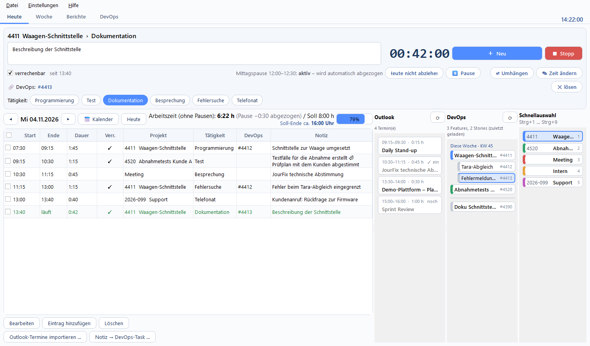
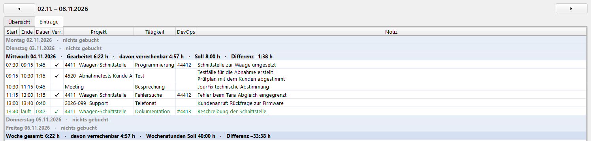
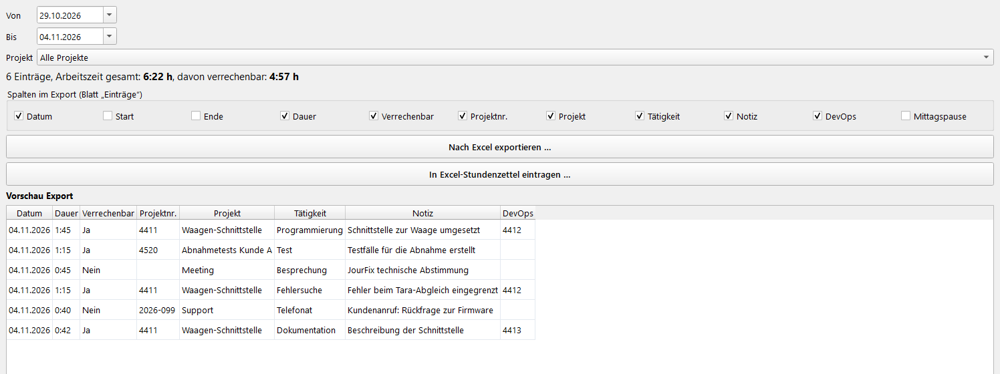
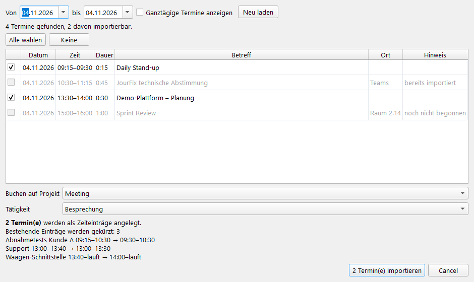
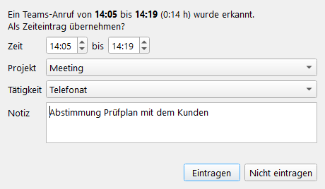
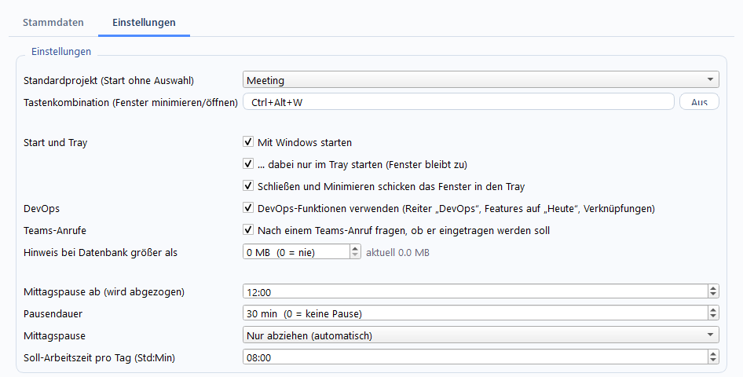

# WorkPlanner

Zeiterfassung mit Schnellauswahl, Tätigkeiten, lückenloser Zeitleiste, Mittagspause (wird am Tagesende abgezogen),
DevOps- und Outlook-Anbindung und Eintrag in einen Excel-Stundenzettel.

## So sieht es aus
Alle Bilder zeigen Beispieldaten (`tools/make_screenshots.py` erzeugt sie neu).

**Heute:** laufende Aufgabe, Einträge des Tages, Outlook-Termine, DevOps-Features und Schnellauswahl


**Woche** mit Soll und Differenz je Tag und für die Woche


**Berichte und Export** mit frei wählbaren Spalten und Vorschau


| Outlook-Termine übernehmen | Teams-Anruf eintragen |
|---|---|
|  |  |

**Einstellungen**


Ein ausführliches **Handbuch** (PDF mit Bildschirmfotos) liegt dem Installer bei und öffnet sich im Programm mit F1.

## Funktionen
- Zeitleiste ohne Lücken und Überschneidungen, Notizen, Tätigkeiten, „verrechenbar“, Mittagspause und Soll-Arbeitszeit
- Outlook-Termine mit einem Klick als Eintrag übernehmen (klassisches Outlook, nur lesend)
- Teams-Anrufe erkennen und nach dem Ende als Eintrag anbieten
- optional Azure DevOps: Features und Stories verknüpfen, Stunden nach „Completed Work“ übertragen
- Wochenübersicht, Excel-Export mit wählbaren Spalten und Eintrag in einen Excel-Stundenzettel
- Eigene Excel-Vorlage per Assistent zuordnen („Einstellungen → Vorlage zuordnen …“): Blattnamen, Projektnummer und/oder
  Name, Grenzen der Projektzeilen, Wochentage Mo–Sa oder Mo–So; Profile lassen sich exportieren und importieren
- Updates aus den GitHub-Releases, nur manuell (Hilfe → Über WorkPlanner / Updates), mit Prüfsummen-Kontrolle
- Beim ersten Start auf Wunsch Beispieldaten zum Ausprobieren (jederzeit mit „Hilfe → Beispieldaten entfernen“ wieder weg)
- Daten lokal in einer SQLite-Datei, DevOps-Token mit der Windows-Benutzerverschlüsselung geschützt

## Lizenz
MIT-Lizenz (siehe `LICENSE`): nutzen, ändern, weitergeben und verkaufen ist erlaubt; es gibt keine Gewährleistung und
keine Haftung des Autors. Im Programm: Menü „Hilfe → Lizenz“.

## Mitwirken
Der Quelltext ist öffentlich einsehbar. **Fehler und Wünsche** bitte als
[Issue](https://github.com/michael-nesensohn/WorkPlanner/issues) melden – dabei **keine Firmen-, Kunden- oder persönlichen
Daten** (auch nicht auf Bildschirmfotos) angeben. Änderungen am Quelltext macht nur der Autor; Pull Requests werden nicht
angenommen. Nach der MIT-Lizenz darfst du dir eine eigene Kopie (Fork) anlegen und sie ändern.

## Lokal testen (Entwicklungszustand)
```
.\dev-test.ps1                  # startet die GUI aus dem Quelltext, in einer EIGENEN virtuellen Umgebung (.venv)
.\dev-test.ps1 -Zuruecksetzen   # dito, mit frischer leerer Datenbank (wie nach einer Neuinstallation)
.\dev-test.ps1 -Tests           # statt der GUI: alle automatischen Tests
.\dev-test.ps1 -Excel           # + Roundtrip mit echtem Excel an einer Kopie von testdaten\nem_2026_TEST.xlsx
.\dev-test.ps1 -Installer       # + Installer: Neuinstallation, Update, Deinstallation (Testvariante)
.\dev-test.ps1 -Alles           # alle drei Prüfungen, mit Ergebnisübersicht; -Alles -Start öffnet danach die GUI
.\dev-test.ps1 -VenvNeu         # virtuelle Umgebung vorher neu aufbauen (wie auf einem frischen Rechner)
```
Das Skript legt beim ersten Mal die venv an und installiert `requirements-dev.txt` hinein (einige Minuten, danach
nur noch bei Änderungen). Getestet wird nur mit diesen Paketen, nicht mit dem, was sonst auf dem Rechner liegt.
Die GUI läuft **isoliert**: eigene Datenbank in `testdaten\appdata`, keine Tastenkombination, kein Tray, keine
„nur eine Instanz“-Sperre. Deine installierte Version und deine echten Daten bleiben unberührt, auch wenn sie läuft.
(Dafür gibt es die Umgebungsvariablen `WORKPLANNER_DATA` = Datenordner und `WORKPLANNER_ISOLATED=1`.)

Direkt, ohne das Skript: `pip install -r requirements-dev.txt` und `python src/main.py` bzw. `python -m pytest`.
Daten liegen sonst in `%APPDATA%\WorkPlanner\workplanner.db`. `testdaten\Testdatei-zuruecksetzen.ps1` setzt die
Excel-Testkopie zurück.

## Installer bauen
```
./dev-build.ps1      # erzeugt dist\installer\WorkPlanner-Setup-<Version>.exe
```
Voraussetzungen: `pip install pyinstaller pillow` und Inno Setup 6 (`winget install JRSoftware.InnoSetup`).
Die Version steht in `pyproject.toml`; jeder Bau (`dev-build.ps1`) erhöht sie automatisch um 1 (Patch) und schreibt sie nach `src/workplanner/_version.py` (Anzeige im Fenstertitel). Das Skript zeichnet das Symbol (`assets/workplanner.ico`), baut das Programm
mit PyInstaller nach `dist\WorkPlanner\` und packt es mit `installer\WorkPlanner.iss` zu einem Setup.

Der Installer:
- installiert nach `C:\Projects\SW-Tools\WorkPlanner\` (im Dialog änderbar), ohne Administratorrechte
- Startmenü: Ordner „WorkPlanner“ mit dem Programm und „WorkPlanner deinstallieren“ (Auswahl im Installer, voreingestellt);
  optional Desktop-Verknüpfung und „Mit Windows starten (nur Tray)“
- **Neuinstallation: leere Datenbank.** Liegt noch eine Datenbank einer früheren Installation in
  `%APPDATA%\WorkPlanner\`, wird sie nicht gelöscht, sondern als `workplanner.db.vorher-<Datum>` beiseite gelegt
- **Update: die vorhandene Datenbank bleibt unverändert.** Der Installer erkennt ein Update an der vorhandenen
  Installation und beendet dazu ein laufendes WorkPlanner
- Deinstallation: über „Apps & Features“, den Startmenü-Eintrag oder `unins000.exe`. Die Daten bleiben stehen,
  außer man bestätigt das Löschen. Auch der Autostart-Eintrag wird entfernt
- schreibt `installiert.json` (Version, Zeitpunkt) wie die anderen Werkzeuge in `C:\Projects\SW-Tools`

Testläufe des Installers (ohne die echte Installation und deren Daten anzufassen): beim Kompilieren
`/DAppName=WorkPlannerTest /DAppGuid=<andere GUID> /DTestBuild=1 /DOutDir=..\dist\installer-test`, beim Ausführen
`/DIR=<Testordner> /DATADIR=<Testordner für die Datenbank>`.

### Release auf GitHub
```
.\dev-release.ps1             # Tests, Installer bauen, Version einchecken, Tag v<Version> setzen, GitHub-Release anlegen
.\dev-release.ps1 -Entwurf    # Release nur als Entwurf (erst nach „Veröffentlichen“ sichtbar)
```
Voraussetzung: GitHub CLI (`winget install GitHub.cli`, einmal `gh auth login`) und ein sauberer Arbeitsordner auf `main`.
Das Release enthält den Installer und das Handbuch; die Änderungsliste erzeugt GitHub aus den Commits.

Der Installer legt auch das Handbuch mit (`Handbuch\WorkPlanner-Handbuch.pdf`, Startmenü-Eintrag und „Hilfe → Handbuch öffnen“, F1 springt zum passenden Kapitel).
`dev-build.ps1` erzeugt es vorher neu mit `tools\make_manual.py` (Bildschirmfotos der echten Oberfläche, Beispieldaten).

## Aufbau (`src/workplanner`)
- `timeline.py` – reine Zeitleisten-Logik (Verschieben, Einfügen, Löschen, Mittagspause)
- `db.py` – SQLite; `service.py` – Anwendungslogik mit Vorschau; `export.py` – Excel
- `ui/` – PySide6-Oberfläche
